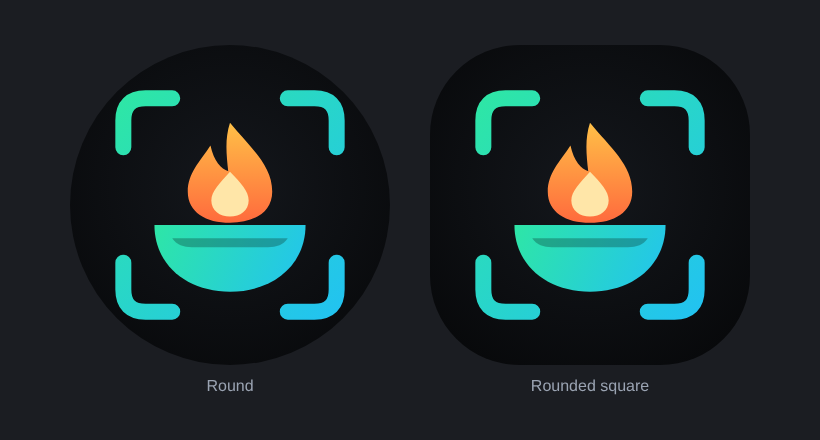

# CalorieLens

Snap a photo of any meal and get calories, macros and nutrients instantly — fully on-device.
No backend, no cloud APIs, no account. Everything is stored locally on the phone.



## Features

- **AI food scanner**: CameraX viewfinder with an animated laser, tap-to-focus ring, pinch/zoom chips (1x/2x/3x),
  flash modes, front/back switch, gallery import and a shutter flash + haptics.
- **Analysis screen**: animated detection brackets, rippling node mesh, progress ring and step checklist while the
  on-device TensorFlow Lite model runs.
- **Results**: calories, protein/carbs/fat donut, health score gauge, health tags, full nutrition facts with
  % daily value and vitamins & minerals (Premium). Wrong guess? Switch to an alternative in one tap.
- **Auto meal log**: every scan is saved automatically with its photo and the right meal (breakfast/lunch/snack/dinner).
- **Today dashboard**: animated calorie ring, macro progress, streak and today's meals.
- **History**: week strip calendar with daily totals (free: last 7 days, Premium: unlimited).
- **Insights**: 7-day bar chart (free) and 30-day trend (Premium), averages and macro split.
- **Profile & settings**: personalised targets (Mifflin–St Jeor), Dark (default) / Light / System theme, kg/lb,
  erase all data.
- **Premium (mock billing)**: animated paywall with plan cards, simulated checkout, success celebration and restore.
- **AdMob**: adaptive banner, interstitial after every 2 scans, rewarded ad for +3 daily scans. Hidden for Premium.

## Tech stack

Kotlin · Jetpack Compose (Material 3) · MVVM · Hilt · Room · DataStore · CameraX · TensorFlow Lite Task Library ·
Coil · Navigation Compose · Coroutines/Flow · Google Mobile Ads.

## On-device model

Recognition uses Google's AIY *vision classifier food V1* TFLite model (~2,000 dishes). It is not committed; place it
at `app/src/main/assets/models/food_model.tflite` (the CI build downloads it automatically). Labels are mapped to a
bundled nutrition database of ~200 foods (`data/nutrition/FoodDatabase.kt`) with typical-serving values.

## Before publishing

- Replace the AdMob **test** IDs in `AndroidManifest.xml` and `ads/AdsManager.kt` with your own.
- Replace the mock `premium/PremiumManager.kt` with Google Play Billing.
- Release builds are signed with the debug key for side-loading; configure your own signing key for Play.

## Build

```bash
./gradlew assembleRelease   # app/build/outputs/apk/release/app-release.apk
./gradlew testReleaseUnitTest
```
