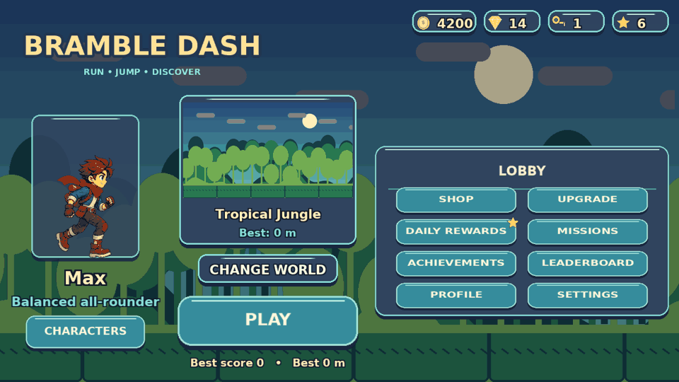

# Bramble Dash

A 2D side-scrolling endless runner for Android (landscape), written in Kotlin with LibGDX.
Five runners race through eight worlds, dodge 30 kinds of hazards and 10 enemy types, fight
five bosses, and spend earned coins on runners, upgrades and rewards. It is fully offline and
single-player, with no ads, no accounts, no analytics and no network permission.



## Contents

| Path | What it is |
|---|---|
| `core/` | All game code (shared Kotlin module): simulation, rendering, UI, audio, saves, progression |
| `android/` | Android launcher module (AGP build, manifest, icons) |
| `lwjgl3/` | Desktop launcher for testing (keyboard controls, screenshot tour) |
| `android-offline/` | Fallback APK build used when Google's Maven/SDK servers are unreachable |
| `assets/` | Runtime assets **generated** from `assets.zip` and the audio generator (committed so builds need no Python) |
| `assets.zip` | The supplied art pack (source of truth for all artwork) |
| `tools/` | Asset pipeline, audio generator, offline APK script, audio validation, asset-usage report |
| `docs/` | Game design reference, asset-usage report, validation report, screenshots |
| `dist/bramble-dash-debug.apk` | Debug APK built from this commit (see "Android APK") |

## Toolchain

| Component | Version | Notes |
|---|---|---|
| Kotlin | 2.2.21 | `jvmTarget` 1.8 for the shared module (desktop + Android) |
| LibGDX | 1.13.1 | core, LWJGL3 backend, Android backend |
| Gradle | 8.14.3 (wrapper) | |
| Android Gradle Plugin | 8.10.1 | compileSdk/targetSdk 35, minSdk 26 (Android 8.0) |
| JDK | 17+ (tested with 21) | |

KGP 2.2.x supports AGP up to 8.10, and AGP 8.10 needs Gradle 8.11.1 or newer, so these versions are mutually compatible.

## Build and run

```bash
# desktop (testing)
./gradlew :lwjgl3:run
./gradlew :lwjgl3:run -Pargs="--size 1600x720 --world city --character robo_x"

# unit, asset-integrity and fairness tests
./gradlew :core:test

# Android (needs the Android SDK: Android Studio, or ANDROID_HOME / local.properties sdk.dir)
./gradlew :android:assembleDebug        # -> android/build/outputs/apk/debug/
```

The `:android` module is included automatically when an Android SDK is configured, so
desktop builds and tests work on machines without one. Open the project folder in Android Studio
and run the `android` configuration.

**Release builds:** no signing keys are committed. Add your own keystore to
`android/build.gradle.kts` (or sign the unsigned release APK).

**Change the app id** in `gradle.properties` (`appId=com.bramble.dash`).

### Android APK without Google's servers

`tools/build_apk_offline.sh` builds a signed debug APK with `aapt`, `dx`, `zipalign` and
`apksigner` (Debian/Ubuntu: `apt install aapt dalvik-exchange zipalign apksigner`). It compiles
the same launcher sources against a public `android.jar` (API 34). It was used for
`dist/bramble-dash-debug.apk` because this project was built in a container that cannot reach
`dl.google.com`. With a normal Android SDK, prefer `./gradlew :android:assembleDebug`.

### Regenerating assets

```bash
python3 -I tools/asset_pipeline.py      # assets.zip -> assets/atlas, assets/data, assets/fonts
python3 -I tools/audio_gen.py           # -> assets/audio (needs numpy and ffmpeg with libvorbis)
python3 -I tools/validate_audio.py      # decode + measure every audio file
python3 -I tools/asset_usage_report.py  # -> docs/ASSET_USAGE.md
```

The asset pipeline:

* extracts the zip safely, rejecting entries that escape the destination and symlinks;
* repacks the eight source atlases into small per-group atlases (runner, world, enemy, boss,
  items, obstacles, effects, UI), keeping every region name;
* trims transparent borders, stores the trim as LibGDX `orig`/`offset` fields and aliases
  pixel-identical frames;
* converts `panel.9.png` into a real NinePatch region, with splits measured from its marker border.

A run keeps about 100–125 MiB of textures resident. Loading every source page at once would take
608 MiB.

## Controls

| Action | Touch | Keyboard (desktop) |
|---|---|---|
| Jump / double jump | JUMP button (bottom right) or swipe up | Space / Up / W |
| Jetpack thrust | hold JUMP | hold Space |
| Slide (in the air: fast-fall into a slide) | SLIDE button (bottom left) or swipe down | Down / S |
| Energy blast (boss fights only) | ENERGY BLAST button | F / X / Enter |
| Pause | PAUSE button / Android back | P / Esc |

Settings can swap JUMP to the left side and turn swipes off.

## Game overview

See [docs/GAME_DESIGN.md](docs/GAME_DESIGN.md) for every number.

* **Runners:** Max (free, balanced), Luna (air control), Rex (+1 heart, longer recovery),
  Ninja Kai (45% longer slide), Robo X (magnet lasts 50% longer). Coin unlocks.
* **Worlds:** Tropical Jungle, Sunny Green Forest, Hot Desert, Snowy Mountain, Dark Haunted Forest,
  Futuristic City, Volcanic Lava World, Magical Fantasy Kingdom. Each has its own parallax art,
  hazards, enemy pool, ambience, difficulty and bosses. The first is open; defeating a world's
  first boss unlocks the next.
* **Bosses:** Giant Jungle Guardian, Desert Scorpion King, Ice Monster Titan, Mechanical Robot
  Destroyer and Shadow Dragon. The first boss comes at 750 m, then one every 1,250 m. Each boss has
  telegraphed low/high attacks and a faster second phase. You fight back with a cooldown energy
  blast.
* **Fair generation:** levels come from seeded, reusable patterns. Spacing is derived from
  jump/slide physics at the current speed, so a dodge window always exists. A bot test plays 32
  seeded runs (8 worlds × 4 seeds) to 3,200 m, including bosses, without taking a single hit.
* **Economy:** coins, gems, keys, chests and bonus tokens. There is a shop, five upgrade tracks,
  mystery boxes (odds published), a 7-day daily reward, 33 missions, 19 achievements, a local
  leaderboard and a profile.
* **Audio:** 28 effects plus menu, run and boss music and 5 ambience loops. All were generated
  procedurally by `tools/audio_gen.py`; no samples were downloaded.

## Known limitations

* **Art:** the supplied character, enemy and boss animations are cutout deformations of single
  poses, not hand-drawn cycles. The game adds a landing squash and hit tints but cannot add
  frames. Supporting art (obstacles, items, VFX) is simpler, and several obstacle types share
  construction. Collision boxes are tuned in code: the pack's AABBs are scaled to 78%, and the
  runner uses fixed stand and slide boxes.
* **Testing:** not tested on a physical Android device or emulator. The APK builds, is signed and
  passes `apksigner verify` and `aapt dump badging`, but it has not been launched. Frame rate was
  only observed in a software-rendered desktop window (about 55–60 FPS in Xvfb). Audio playback
  latency was not measured; the CI container had no sound device.
* **AGP build:** `./gradlew :android:assembleDebug` could not be run in the development
  container, which blocks `dl.google.com`. Its configuration follows the standard LibGDX layout.
* **Daily rewards** use the device's local calendar day, so changing the device date affects them.
  Moving the clock back blocks claiming until the stored day passes.
* **Ads:** the pack's rewarded-ad buttons are hidden because no ad service is integrated.
* **Leaderboard** is local to the device only.
