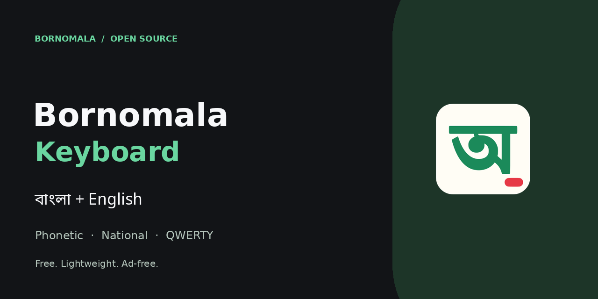

<p align="center"></p>

# Bornomala Keyboard (বর্ণমালা)

A fast, lightweight Bangla + English keyboard for Android, written in Kotlin with Jetpack Compose.
Free and open source: **no ads, no premium tier, no internet permission**.

## Features

- **Three typing modes**
  - **Bangla Phonetic (অভ্র style):** type `ami tOmake bhalobashi` and get `আমি তোমাকে ভালোবাসি`. Avro-compatible rules, with dictionary suggestions that fix casual spellings (`shobai` → `সবাই`, `kotha` → `কথা`).
  - **Bangla National (জাতীয়):** the Bangladesh Jatiyo layout with Ridmik-style key placement. Smart vowels: a vowel sign at the start of a word, or after hasanta, becomes the full vowel (্ + া → আ).
  - **English:** QWERTY with suggestions, typo auto-correct (`teh` → `the`), auto-capitalisation and accented letters on long-press.
- 80,000-word Bangla and 50,000-word English dictionaries, plus words learned on the device.
- Emoji panel (with recent emoji and kaomoji), clipboard history with pinning, and a text-editing panel (cursor, select, copy, cut, paste).
- 14 themes: Light, Dark, AMOLED, Green, Ocean, Rose, Material You (dynamic colours), Follow system, and 6 image themes.
- Number row, keyboard height, one-handed mode, key popups, long-press hints, vibration and sound.
- Gestures: slide on the space bar to move the cursor, slide left from backspace to delete words, double-space for a full stop (`।` in Bangla).
- Backup and restore of settings and learned words.
- Password fields and incognito fields never learn words.

## Install

Download the latest APK from **[Releases](../../releases)** (or from the build artifacts in **Actions**), open it on your phone, then open the *Bornomala Keyboard* app and follow the two setup steps.

## Build

```bash
./gradlew assembleRelease        # app/build/outputs/apk/release/app-release.apk
./gradlew testDebugUnitTest      # engine unit tests
```

Requires JDK 17 and the Android SDK (compileSdk 35). Release builds use R8 and resource shrinking, so the APK stays small (a few MB).

## Release signing

The GitHub Actions workflow (`.github/workflows/android.yml`) builds the release APK on every push. It publishes a GitHub Release for `v*` tags, for pushes to `main`, and for commits whose message contains `[release]`.

To sign every release with **your own permanent key** (needed so that updates install over older versions), add these repository secrets under *Settings → Secrets and variables → Actions*:

| Secret | Value |
|---|---|
| `KEYSTORE_BASE64` | `base64 -w0 release.jks` |
| `KEYSTORE_PASSWORD` | keystore password |
| `KEY_ALIAS` | key alias |
| `KEY_PASSWORD` | key password |

Create a key with:

```bash
keytool -genkeypair -v -keystore release.jks -alias bornomala -keyalg RSA -keysize 4096 -validity 10000
```

Without these secrets the APK is signed with a temporary key. It installs fine, but you must uninstall it before installing a build signed with a different key. Never commit your keystore; this repository is public.

## Project layout

```
app/src/main/java/com/bornomala/keyboard/
  engine/   Avro phonetic, phonetic matching, Jatiyo rules, dictionaries (pure Kotlin, unit tested)
  ime/      InputMethodService, canvas keyboard view, suggestion strip, emoji/clipboard/edit panels
  layout/   English, Phonetic, National, symbol and number-pad layouts
  theme/    Keyboard themes
  ui/       Compose settings app and setup wizard
```

## Credits

- Phonetic rules follow the Avro Phonetic scheme by OmicronLab. This project is independent and is not affiliated with OmicronLab or Ridmik.
- Word frequency lists are derived from [wordfreq](https://github.com/rspeer/wordfreq) (data under CC BY-SA 4.0).
- Emoji data comes from [unicode-emoji-json](https://github.com/muan/unicode-emoji-json) (MIT).

## License

Code: Apache License 2.0 (see `LICENSE`). Dictionary data: CC BY-SA 4.0.
