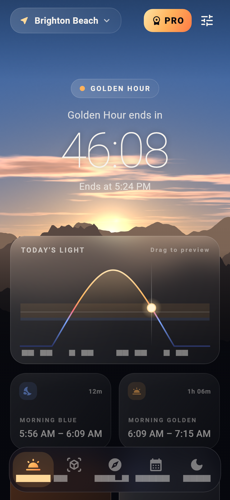
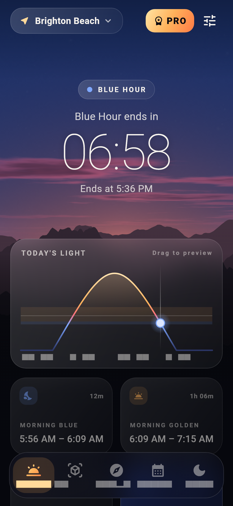
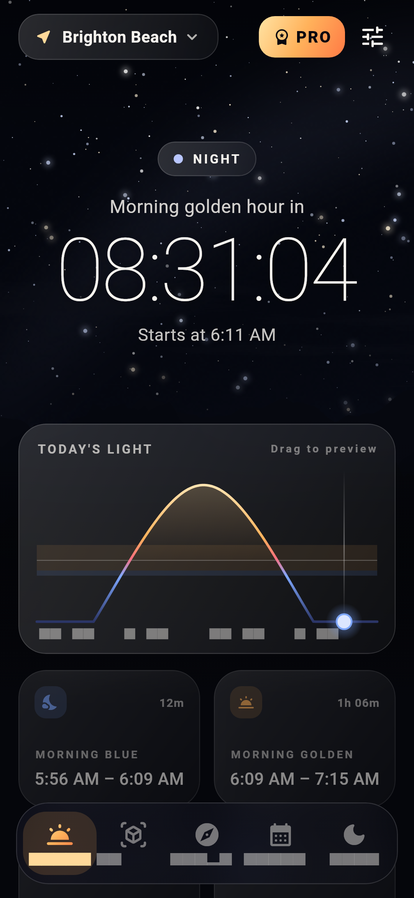
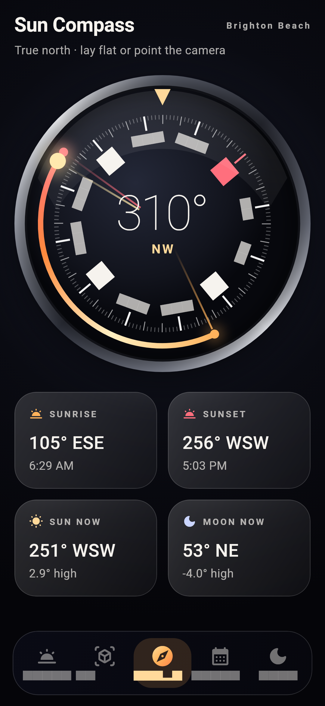
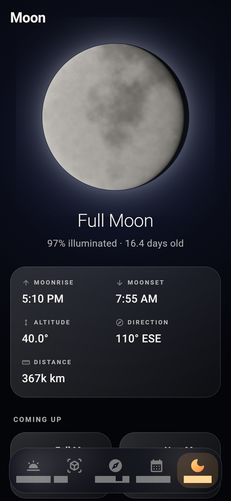
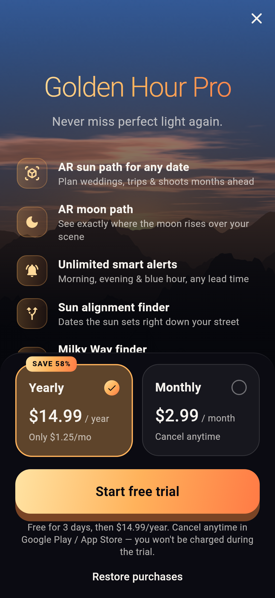

# Golden Hour Compass (Flutter)

Offline golden hour, blue hour, AR sun path, compass and moon planner for photographers.
No backend, no login, no internet needed for any calculation.

| Golden hour | Blue hour | Night | Compass | Moon | Pro |
|---|---|---|---|---|---|
|  |  |  |  |  |  |

> Screenshots are rendered by `test/screenshots_test.dart`. Grey blocks in a few small labels are the
> test font only; on a phone they use the system font.

## Features

| Feature | Free | Pro |
|---|---|---|
| Live countdown, today's golden/blue hour, sunrise, sunset | ✅ | ✅ |
| Realistic animated sky (GLSL shaders) + drag-to-preview day arc | ✅ | ✅ |
| AR sun path for **today** | ✅ | ✅ |
| AR sun path for **any date** | 🎁 rewarded ad, 24h | ✅ |
| AR moon path | ❌ | ✅ |
| True-north sun compass | ✅ | ✅ |
| Moon phase, rise/set, 30-night calendar | ✅ | ✅ |
| Planner for other dates | 🎁 rewarded ad, 24h | ✅ |
| Shadow calculator | 🎁 rewarded ad, 24h | ✅ |
| Sun alignment finder ("Manhattanhenge") | ❌ | ✅ |
| Milky Way finder | ❌ | ✅ |
| Pro camera settings (ISO / shutter / aperture / WB) | ❌ | ✅ |
| Alerts | 1/day (evening, 20 min) + 🎁 extra morning alert | Unlimited, any lead time |
| Saved places | 2 | Unlimited |
| Ads | Interstitial + rewarded (**no banners**) | None |

### Ad rules (`lib/services/ads_service.dart`)
- Interstitial only when **leaving** the AR or Planner tab. Never over the camera and never on first launch.
- At most one every 3 minutes and 5 per day. Never shown to Pro users.
- Google UMP consent form (GDPR) runs before any ad is requested.

## Before publishing: replace these

1. **AdMob IDs.** These are Google's test IDs right now.
   - `android/app/src/main/AndroidManifest.xml` → `com.google.android.gms.ads.APPLICATION_ID`
   - `ios/Runner/Info.plist` → `GADApplicationIdentifier`
   - `lib/services/ads_service.dart` → `AdIds.interstitial` / `AdIds.rewarded`
2. **Subscriptions.** Create these in the Play Console (Monetize → Subscriptions) and in App Store Connect:
   - `golden_pro_monthly`: $2.99 / month
   - `golden_pro_yearly`: $14.99 / year with a **3-day free trial** offer
3. **Privacy policy URL** in `lib/screens/settings_screen.dart` (required by Google Play).
4. **Application ID** `com.goldenhour.golden_hour` in `android/app/build.gradle.kts`, plus the app icon and a signing key.

## Build & run

```bash
flutter pub get
flutter run                      # on a real phone (camera + compass need real sensors)
flutter build appbundle          # Play Store upload (.aab)
TZ=UTC flutter test              # astronomy tests + screenshot rendering
```

## Project structure

```
lib/
  astro/       sun_calc.dart (sun/moon math), day_light.dart (golden/blue hour), extras.dart (alignment, Milky Way, shadow, photo tips)
  services/    app_state, ads, purchases (subscriptions), notifications, location, orientation (sensor fusion)
  widgets/     sky/ (shader sky, clouds, stars, moon, mountains, lens flare), day_arc, glass UI, feature gates
  screens/     home, AR, compass, planner, moon, paywall, settings, onboarding
shaders/       sky.frag, clouds.frag, moon.frag
android/…/MainActivity.kt   magnetic declination (true north) via Android GeomagneticField
```

## Notes
- Times are accurate to about a minute (verified against London and New York solstice times in `test/astro_test.dart`).
- Weather and clouds are **not** forecast, because that would need an internet API.
- On iOS the compass uses magnetic north (the declination channel is Android only for now).
