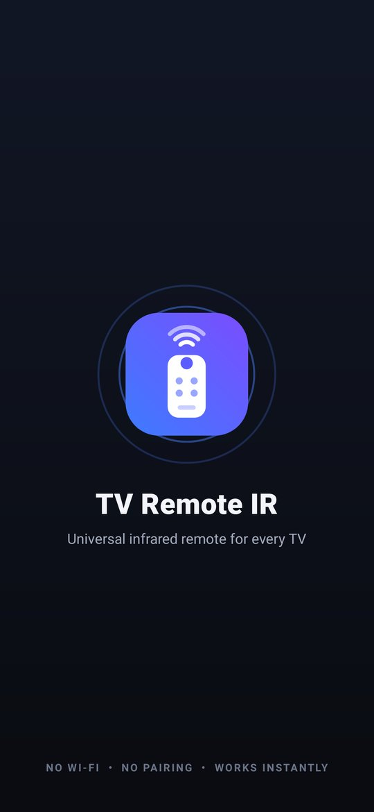
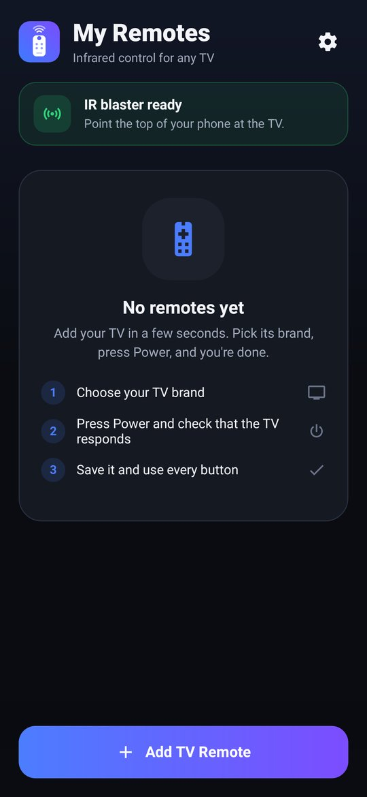
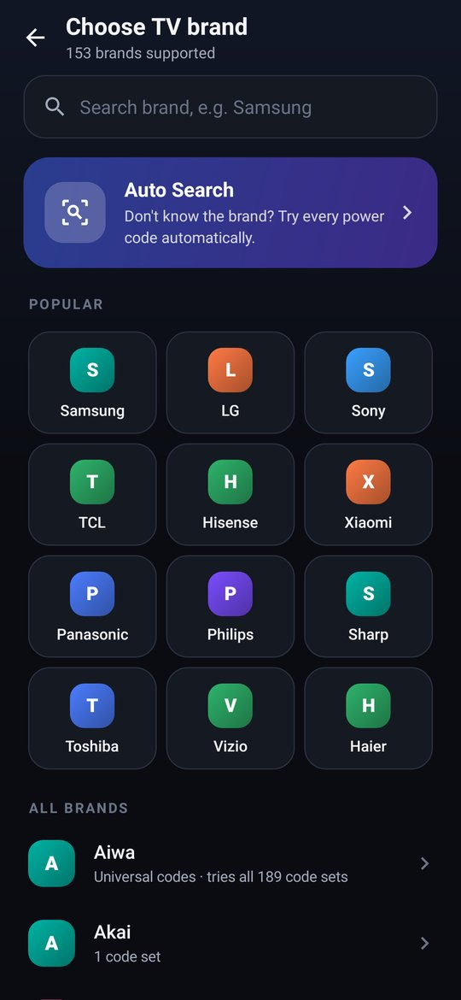
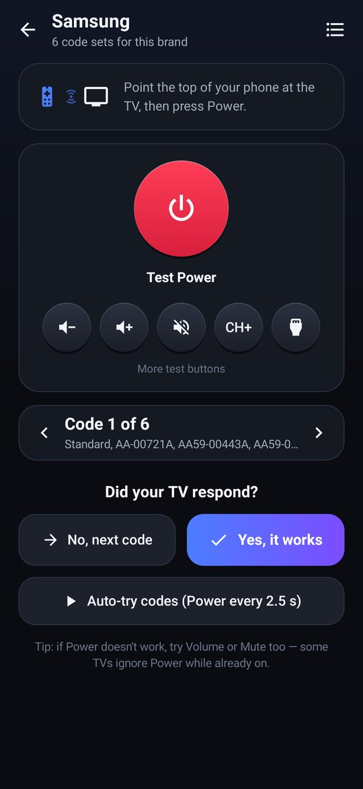
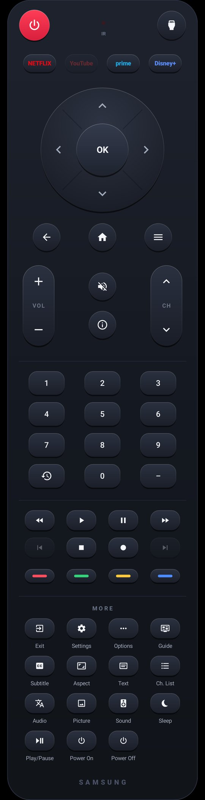
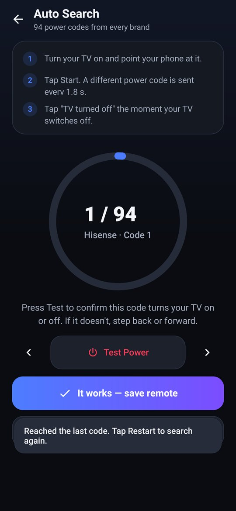

# TV Remote IR

A universal infrared TV remote for Android phones that have an IR blaster (Xiaomi, Redmi, POCO, some Vivo, Huawei and Honor).
No Wi-Fi, no pairing: it works like the TV's own remote, including **turning the TV on**.

Ready-to-install APK: [`release/TV-Remote-IR.apk`](release/TV-Remote-IR.apk) (≈230 KB, Android 5.0+).

| Splash | Home | Brands | Code match | Remote | Auto Search |
|---|---|---|---|---|---|
|  |  |  |  |  |  |

## Features

- **153 brands**: 116 with their own code sets, plus 37 popular brands (Walton, Vu, Onida, Singer, Skyworth, …) that search the whole library ("Universal codes").
- **Code match**: pick a brand, press Power (or Vol / Mute / CH+ / Input), then answer "Did your TV respond?". You can also step through codes, choose one from a list, or let the app auto-try a code every 2.5 s.
- **Auto Search**: sends every distinct power code from every brand (94) at 1.8 s intervals. Tap Stop when the TV turns off, confirm with Test, then save.
- **Full remote**: Power, Input, Netflix / YouTube / Prime / Disney+, D-pad + OK, Back / Home / Menu, Volume and Channel rockers (auto-repeat while held), Mute, Info, number pad, Last channel, playback keys, colour keys, and a "More" section with every extra key the TV supports (Exit, Settings, Guide, Subtitle, Aspect, Sleep, discrete Power On/Off, …). Keys a code set doesn't have are dimmed.
- An IR LED on the remote lights up while a signal is sent. Vibration feedback can be turned off.
- Saved remotes keep their full code map, open directly on the next launch, and can be renamed, re-matched or deleted.

## How IR works here

1. Each code in `app/src/main/assets/irdb.txt` is a protocol + address + command (or raw timings).
2. `IrEncoder` turns it into the carrier frequency and mark/space pattern in microseconds. Supported protocols: NEC, NEC-ext, Samsung32, Sony SIRC 12/15/20, Philips RC5/RC5X/RC6, Panasonic/Kaseikyo, RCA, Pioneer, and raw captures.
3. `IrTransmitter` sends it with Android's `ConsumerIrManager` on a background thread, so the UI never stalls.

**Power on works** because a TV in standby keeps its IR receiver powered (the red standby light). It receives the Power code just as it would from the original remote.

No app can detect a TV automatically over IR, because IR is one-way. That's why the app uses brand selection plus a Power test, or Auto Search.

## Project layout

```
app/src/main/java/com/irremote/tv/
  ir/        IrDatabase (code library), IrEncoder (protocols), IrTransmitter (ConsumerIrManager)
  data/      RemoteStore (saved remotes, settings)
  ui/        design tokens, custom-drawn keys, D-pad, rockers, LED, progress ring, logo
  screens/   Splash, Home, Brand, Match, AutoSearch, Remote
tools/
  build_db.py     regenerates irdb.txt from Flipper-IRDB
  gen_icons.py    regenerates the vector icons from Material Design Icons
  build-apk.sh    command-line build (aapt, kotlinc, ProGuard, dx, apksigner)
  ui-test/        Robolectric test that drives every screen with a fake IR emitter and saves screenshots
```

The app uses only the Android framework (no AndroidX), which keeps it fast and tiny.

## Building

- **Android Studio**: open this folder. It's a standard Gradle project (`app/build.gradle.kts`, AGP 8.5, Kotlin 1.9). Run, or Build → Generate Signed APK.
- **Command line without Gradle**: `tools/build-apk.sh` (see the variables at the top of the script). This script built the APK in `release/`.

## Credits

- IR codes: [Flipper-IRDB](https://github.com/Lucaslhm/Flipper-IRDB), CC0 1.0.
- Icons: [Material Design Icons](https://pictogrammers.com/library/mdi/), Apache 2.0.
